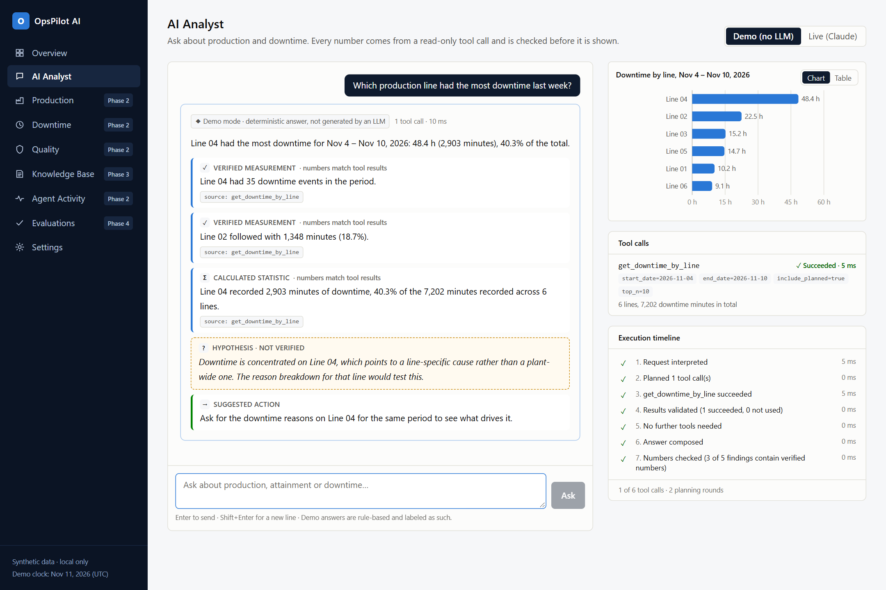
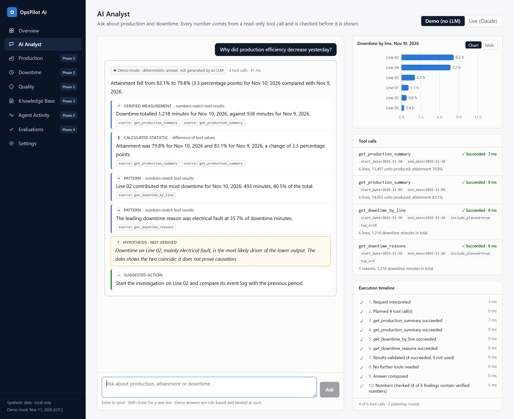
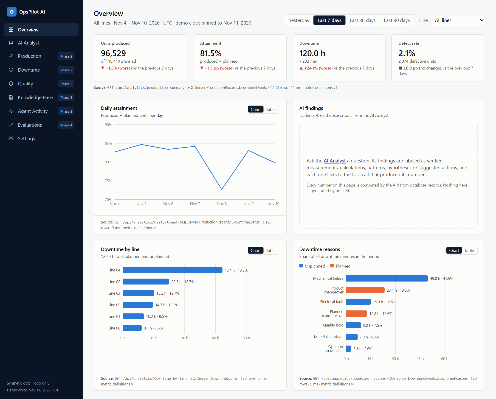

# OpsPilot AI

[](https://github.com/serdemergunn/opspilot-ai/actions/workflows/ci.yml)
[](LICENSE)

**Agentic operations intelligence for manufacturing — evidence-based answers from deterministic tools, not invented numbers.**

> **Status: Phase 1 (working MVP) complete.** Dashboard, analytics API, agent service and AI Analyst run
> end to end with `docker compose up`. Phases 2–5 (more tools, RAG, evaluation, release polish) are next —
> see the [Phase 1 plan](docs/architecture/phase-1-plan.md). Only what is listed under "What works today" is implemented.

OpsPilot AI lets an operations team ask questions such as *"Which production line had the most
downtime last week?"* and get an answer where every number comes from a typed, read-only,
tested backend tool, every chart is built from tool output by code, and every statement is
labeled as a measurement, a calculation, a pattern, a hypothesis or a recommendation.



<details>
<summary><b>More screenshots</b>: a multi-tool answer and the operations dashboard</summary>

**"Why did production efficiency decrease yesterday?"** — four tool calls, a derived calculation
(83.1% → 79.8%, a 3.3-point change computed from two tool results) and a hypothesis that is explicitly
marked as unverified.



**Overview dashboard** — every chart has a table view and names the endpoint, tables and row count behind it.



</details>

Screenshots show demo mode on the synthetic dataset. They are reproducible: `scripts/screenshots`
captures them from a running stack (`npm ci && npm run capture`).

## Core ideas

- **Allowlisted tools, never text-to-SQL.** The model chooses among typed operations with bounded
  parameters; the .NET API validates and executes them read-only.
  ([ADR 0001](docs/decisions/0001-allowlisted-tools-instead-of-text-to-sql.md))
- **One authority for data access.** The AI service holds no database credentials.
  ([ADR 0002](docs/decisions/0002-dotnet-api-as-gateway-and-tool-authority.md))
- **Numbers are verifiable without an LLM.** A second, independent implementation of the metric
  definitions produces golden values that the API and the agent are tested against.
  ([ADR 0003](docs/decisions/0003-pinned-demo-clock-and-independent-oracle.md))
- **Demo mode without API keys**, using the same graph and real tools, clearly labeled as
  deterministic output.

## Architecture

```
React (Vite, TanStack Query, Recharts)
        │  /api/*
        ▼
ASP.NET Core 8 API ──── read-only login ────▶ SQL Server
   │  /api/chat (proxy)        ▲
   ▼                           │ POST /internal/tools/{name}  (allowlist, service key)
FastAPI + LangGraph agent ─────┘
   └─ provider: Anthropic (live) | Deterministic (demo); other LLMs plug into the same Provider interface
```

PostgreSQL + pgvector for the knowledge base arrives in Phase 3.

## What works today

### Quick start (Docker)

Requires Docker. No LLM API key is needed: the agent runs in clearly labeled demo mode by default.

```bash
cp .env.example .env        # then set MSSQL_SA_PASSWORD, OPSPILOT_DB_READER_PASSWORD, OPSPILOT_SERVICE_KEY
docker compose up --build -d
```

Open **http://127.0.0.1:3000**: the Overview dashboard, and **AI Analyst**, where you can ask
*"Which production line had the most downtime last week?"* and get an answer with verified findings, a
chart built from the tool result, the tool calls with their parameters and an execution timeline.
To use Claude, set `ANTHROPIC_API_KEY` in `.env` and pick **Live (Claude)** on the AI Analyst page.

| Service | Address (localhost only) |
|---|---|
| Web (dashboard + AI Analyst) | http://127.0.0.1:3000 |
| .NET API | http://127.0.0.1:8080 |
| AI service (debugging) | http://127.0.0.1:8090 |
| SQL Server | 127.0.0.1:14333 |

### API

```bash
curl http://127.0.0.1:8080/api/meta
curl "http://127.0.0.1:8080/api/analytics/downtime-by-line?startDate=2026-11-04&endDate=2026-11-10"
```

On first start the API applies EF Core migrations, seeds the synthetic dataset and creates a
`db_datareader`-only login that serves every request. The clock is pinned to
`2026-11-11T00:00:00Z` so "last week" matches the dataset.

| Endpoint | Purpose |
|---|---|
| `GET /api/health`, `/api/meta`, `/api/lines` | Status, pinned clock, dataset range, lines |
| `GET /api/analytics/{production-summary, downtime-by-line, downtime-reasons, daily-trend}` | Dashboard data (camelCase) |
| `POST /api/chat` | Ask the agent; validated, rate limited (20/min per client) and forwarded to the AI service |
| `GET /internal/tools` | Tool list with strict JSON schemas (service key required) |
| `POST /internal/tools/{name}` | Allowlisted, read-only agent tools (snake_case, service key required) |

### Run the dashboard in development mode

With the API running (above), for hot reload instead of the web container:

```bash
cd apps/web
npm ci
npm run dev        # http://127.0.0.1:5173 — proxies /api to 127.0.0.1:8080
```

The Overview page shows units produced, attainment, downtime and defect rate with
period-over-period deltas, a daily attainment trend, downtime by line and downtime by reason.
Every chart has a table view and names the endpoint, tables and row count behind it. Other
navigation entries are placeholders labeled with the milestone or phase that delivers them.

### Ask the agent directly (AI service)

The browser goes through `/api/chat`; for debugging, the agent service also listens on `127.0.0.1:8090`:

```bash
curl -s -X POST http://127.0.0.1:8090/v1/chat   -H "X-OpsPilot-Service-Key: <OPSPILOT_SERVICE_KEY from .env>" -H "Content-Type: application/json"   -d '{"messages":[{"role":"user","content":"Which production line had the most downtime last week?"}]}'
```

The response contains a summary, findings labeled measurement / calculation / pattern / hypothesis /
recommendation, charts built from tool results, every tool call with its status and duration, a timeline
and any warnings. Every number in a finding has passed a grounding check against the tool results
([ADR 0004](docs/decisions/0004-grounding-check-and-deterministic-demo-provider.md)). Set
`ANTHROPIC_API_KEY` and `OPSPILOT_MODE=live` to use Claude; see [apps/ai-service](apps/ai-service/README.md).

### Tests

```bash
python -m unittest discover -s tests/data -t .   # dataset integrity + metric oracle (stdlib only)
dotnet test OpsPilot.sln                          # 89 tests; integration tests start SQL Server via Testcontainers
(cd apps/web && npm test)                         # date ranges, formatting, deltas, axis ticks
python -m pytest tests/ai -q                      # agent graph, tools, grounding, limits, injection (in apps/ai-service venv)
```

The integration suite replays all 29 golden cases from the independent Python oracle through the
real HTTP pipeline and SQL Server and requires identical results. It also checks that the request
login cannot write, that unknown tools and extra arguments are rejected, and that a missing service
key returns 401.

See [sample-data/README.md](sample-data/README.md) for the dataset and seeded scenarios, and
[metric-definitions.md](docs/architecture/metric-definitions.md) for exact formulas and rounding.

## Repository layout

```
apps/web          React dashboard (M3 ✓) and AI Analyst (M5 ✓)
apps/api          ASP.NET Core analytics API and tool endpoints (M2 ✓)
apps/ai-service   FastAPI + LangGraph agent (M4 ✓)
sample-data       generator, CSVs, metric oracle, golden values (M1 ✓)
tests/            data (M1 ✓), backend (M2 ✓), ai (M4 ✓), evaluation
docs/             architecture, ADRs, screenshots
```

## Security notes

Local development only: services will bind to `127.0.0.1` and use anonymous access with synthetic
data. Authentication and authorization are required before any public deployment and are planned
for a later phase. Secrets live in `.env` (see `.env.example`), which is git-ignored.

## License

MIT — see [LICENSE](LICENSE). All data is synthetic and all names are fictional.
